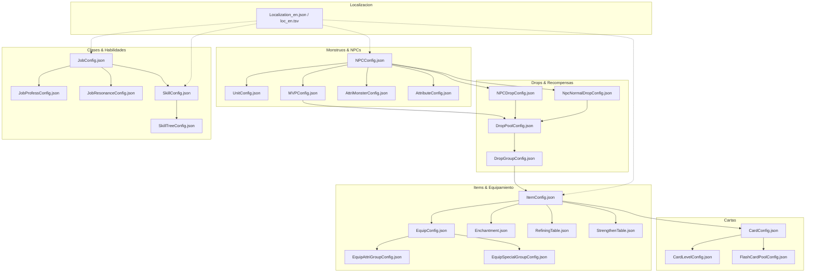

# PLAN MAESTRO DE MIGRACIÓN Y ARQUITECTURA: ERODS A RAGNAROK ONLINE 3 (RO3)

**Versión:** 1.1.0  
**Estado:** Fases 1–3 completadas (Auditoría, ETL de monsters/items/cards/MVPs, extracción de assets e imágenes). Ver sección 8 para el estado real de implementación.  
**Autor:** Arquitecto de Software Senior & Ingeniero de Datos  
**Área de Trabajo:** `C:\Users\Carlos\Downloads\erods\Lro3_DB`  
**Repositorio de Referencia:** `aethai/ro3emu-server` (`C:\Users\Carlos\Downloads\ro3emu-server`)  
**Datos y Cliente del Juego:** `C:\Users\Carlos\Downloads\RO3Emu-win-x64`  

---

## 1. RESUMEN EJECUTIVO Y OBJETIVOS

El proyecto consiste en la modernización y migración arquitectónica integral de la plataforma web de base de datos **ERODS-FUSION** (eRO Database System), originalmente diseñada para Ragnarok Online clásico (Pre-Renewal/Renewal bajo emuladores tipo eAthena/rAthena en PHP 5.2/MySQL), hacia un sistema moderno que sirva como la **Base de Datos Oficial de Ragnarok Online 3 (RO3)**.

La fuente única de verdad para esquemas, reglas de combate, fórmulas de atributos, jerarquía de drops y sistemas de juego es el emulador open-source `aethai/ro3emu-server` (.NET 10 / C# / SQLite) junto con los datos exportados por `Ro3Emu.DataExport` (517 tablas JSON de configuración en `data/config`, 381 mapas y escenas en `data/sceneeditor`, 2222 definiciones de habilidades en `data/skills`, diccionarios de localización `loc_en.tsv` y `Localization_en.json`) y los contenedores de assets Unity (`ro3_Data/StreamingAssets/VFS`).

---

## 2. AUDITORÍA DEL SITIO WEB ACTUAL (`C:\Users\Carlos\Downloads\erods`)

### 2.1 Stack Tecnológico Existente
- **Lenguaje / Motor:** PHP procedural y orientado a objetos temprano (diseñado para PHP 5.2 - 5.4, con advertencias estrictas para `php_mysql` legacy).
- **Controladores y Arquitectura:** Patrón Front Controller (`index.php` -> `root/global.php` -> `root/main.php` -> `root/actions/{action}.php`). Controladores heredan de `Controller` (`ItemController.php`, `MonsterController.php`, `ResultHandler.php`).
- **Base de Datos:** MySQL (tablas MyISAM e InnoDB con prefijos de idioma: `item_db_en_uk`, `item_db_es_mx`, `item_db_pt_br`, `mob_db_*`, `spawns_*`).
- **Frontend y UI:** Plantillas PHP puras (`layout/item/`, `layout/mob/`, `layout/field/`, `layout/world/`), hojas de estilos CSS fijas (`layout/style.css`), JavaScript auxiliar (`sugar.js`, `efficient.js`).
- **Búsquedas:** AJAX y endpoints de sugerencia en tiempo real (`suggest.php`, `ajax.php`, `unisearch.php`).

### 2.2 Entidades Actuales y Tablas en Base de Datos
| Tabla Antigua | Entidad Representada | Características y Limitaciones Clásicas |
| :--- | :--- | :--- |
| `item_db_{locale}` | Ítems, Armas, Armaduras, Cartas, Consumibles | Estructura plana de rAthena. Usa scripts de texto en lenguaje Athena (`script`, `equip_script`), slots de cartas clásicos (0-4), peso en decenas, slots de equipo bitmask (`equip_jobs` int binario de 32 bits). |
| `mob_db_{locale}` | Monstruos, Mini-Bosses, MVPs | 9 columnas fijas de drops normales (`Drop1id`..`Drop9id` y `Drop1per`..`Drop9per`) + 3 columnas fijas de drops MVP (`MVP1id`..`MVP3id`). Stats planos clásicos (STR, AGI, VIT, INT, DEX, LUK, HP, SP). |
| `spawns_{locale}` | Puntos de aparición en mapas | Coordenadas rectangulares `x1, y1, x2, y2`, cantidad y delays `delay1, delay2` por mapa (`prt_fild08`, `pay_fild04`, etc.). |

### 2.3 Diagnóstico de Obsolescencia frente a RO3
1. **Mecánica de Drops:** En RO clásico los drops eran directos por monstruo (porcentaje fijo). En RO3 existe un árbol estocástico multinivel: `NPCConfig` -> `NPCDropConfig` / `NpcNormalDropConfig` -> `DropPoolConfig` (slots con chances por millón, rolls y draws) -> `DropGroupConfig` (pesos ponderados y límites de nivel/clase).
2. **Equipamiento:** En RO3 el equipo posee **Calidad/Rango** (1 al 6), **Power Score** (puntuación de poder), **Appraisal** (tasación que desbloquea afijos aleatorios), **Stunts/Efectos Especiales** (`SpecialEffectConfig`), **Refinamiento estacional** y **Encantamientos** (`Enchantment.json`). Los scripts tipo `itemheal rand(45,65),0;` ya no existen; el cliente y servidor operan con atributos normalizados (`AttributeConfig`).
3. **Cartas:** En RO clásico las cartas eran simplemente ítems equipables en ranuras fijas de armas o armaduras. En RO3 las cartas poseen **Niveles** (1 al 15+), **Tiers/Estrellas**, **Power Score**, ranuras por tipo de pieza (`_iCardPart`), **Cartas Flash** con atributos dinámicos (`FlashCardPoolConfig`) y álbumes de colección de aventuras.
4. **Nivel Máximo y Clases:** RO3 opera con nivel base máximo 99 en su ciclo actual, árboles de talentos de especialización (`JobProfessConfig`), resonancias de profesión (`JobResonanceConfig`) y sinergias de clase.
5. **Nuevos Sistemas Ausentes en RO Clásico:** Mascotas de combate y monturas (`PetBaseConfig`, `MountsConfig`), Tótems (`TotemConfig`), Ecos de Alma (Soul Echoes), Mazmorras e Instancias (`DungeonConfig`, Spirit Tower, Phantom Realm, Realm of the Gods) y Guerra de Territorios (`TerritoryWar`).

---

## 3. FUENTE DE VERDAD: ARQUITECTURA DE DATOS EN `RO3EMU-SERVER`

### 3.1 Tablas Maestras Exportadas (`data/config/`)
La auditoría de `C:\Users\Carlos\Downloads\RO3Emu-win-x64\RO3Emu\data\config` identificó 517 tablas JSON ya extraídas e intactas. Las entidades primarias para la base de datos web son:



### 3.2 Atributos del Sistema (`AttributeConfig.json`)
RO3 unifica todos los modificadores numéricos del juego mediante IDs estándar:
- **Atributos Primarios:** `1: STR`, `2: AGI`, `3: VIT`, `4: INT`, `5: DEX`, `6: LUK`.
- **Atributos Derivados:** `101: HP`, `102: SP`, `103: PATK` (Ataque Físico), `104: MATK` (Ataque Mágico), `105: PDEF` (Defensa Física), `106: MDEF` (Defensa Mágica).
- **Atributos Secundarios:** `107: Recuperación HP`, `108: Recuperación SP`, `109: HIT` (Precisión), `110: FLEE / HUIR` (Evasión), `111: CRIT` (Crítico), `112: CRIT RES` (Resistencia Crítica), `113: MSPD` (Velocidad de Movimiento), `114: ASPD` (Velocidad de Ataque).

### 3.3 Regla de Cálculo de Stats de Monstruos (Descubrimiento en Servidor)
En `NPCConfig`, los monstruos definen `_iAttributeVariated` y `_iLevel`. Según el código fuente verificado en `Ro3Emu.Server/Game/MonsterService.cs`:
$$\text{AttributeLookupID} = (\_iAttributeVariated \times 1000) + \_iLevel$$
Este ID se consulta en `AttriMonsterConfig.json` para obtener los valores base exactos de HP, SP, PATK, MATK, PDEF y MDEF, los cuales luego son modulados por `_kAttriScale`.

### 3.4 Estructura de Assets y Unity AssetBundles
- **Ubicación:** `ro3_Data/StreamingAssets/VFS`
- **Metadatos:** `assetmeta.data` contiene el índice de hashes **MurmurHash3 x64** para mapear los nombres de recursos en minúsculas (ej. `headicon_monster_baphomet_1.png` o `item_1420102.png`) hacia los archivos de bundle (`.bundle`) o contenedores empacados `RO3V` (`.bytes`).
- **Herramienta de extracción probada:** El algoritmo de `tools/WorldData/vfsget.js` permite extraer los bloques binarios directos de los AssetBundles sin requerir el cliente en ejecución.

---

## 4. MATRIZ DE MAPEO DE ESQUEMAS: WEB ANTIGUA -> RO3

### 4.1 Ítems y Equipamiento
#### Tabla Antigua: `item_db_{locale}` -> Nuevas Tablas: `ro3_items` y `ro3_equipment`

| Campo Antiguo | Destino en RO3 | Origen de Datos en RO3 | Regla de Transformación / Notas |
| :--- | :--- | :--- | :--- |
| `id` | `ro3_items.id` | `ItemConfig._iID` | Clave primaria. Ítems van desde IDs de consumibles (1+) hasta cartas (1400000+) y equipo (2000000+). |
| `name_english` | `ro3_items.name_en` | `Localization_en.json` vía `ItemConfig._iName` | Resuelto mediante el ID de localización en `Localization_en.json`. |
| `name_japanese` | `ro3_items.name_zh` / `name_es` | `Localization_zh_CN.json` / `loc_en.tsv` | Soporte multi-idioma (Español e Inglés nativo). |
| `type` | `ro3_items.type`, `subtype` | `ItemConfig._iType`, `_iSubType` | Tipos RO3: 1: Moneda, 2: Consumible, 3: Material, 4: Carta, 5: Equipo, etc. |
| `price_buy` | `ro3_items.price_buy` | `ItemConfig._kSell` | Moneda y costo de adquisición en tiendas. |
| `price_sell` | `ro3_items.price_sell` | `ItemConfig._kSell` | Valor de venta o reciclaje. |
| `weight` | **ELIMINADO** | *No aplica* | RO3 no utiliza sistema clásico de peso en inventario; usa límite de slots (`BackpackConfig`). |
| `attack` | `ro3_equipment.base_patk`, `base_matk` | `EquipConfig._kBasicAttribute` | Dividido en PATK y MATK explícitos según `AttributeConfig` 103 y 104. |
| `defence` | `ro3_equipment.base_pdef`, `base_mdef` | `EquipConfig._kBasicAttribute` | Dividido en PDEF y MDEF explícitos (IDs 105 y 106). |
| `range` | `ro3_equipment.attack_range` | `JobAttackConfig` / `EquipConfig` | Rango de ataque dependiente del tipo de arma. |
| `slots` | `ro3_equipment.card_slots` | `CardHoleConfig` / `ItemConfig._iEnchantSlot` | Slots de cartas y slots de encantamiento independientes. |
| `equip_jobs` | `ro3_equipment.job_restrictions` | `ItemConfig._kJobNeed` / `EquipConfig` | Reemplazado de bitmask binario a lista de IDs de clase de RO3. |
| `equip_level` | `ro3_items.level_required` | `ItemConfig._iLevelNeed` | Nivel mínimo requerido (1-99). |
| `refineable` | `ro3_equipment.is_refineable` | `RefiningTable` / `ItemConfig` | Vinculado a las tablas de refinamiento estacional. |
| `view` | `ro3_items.icon_name`, `model_name` | `ItemConfig._kIcon`, `EquipConfig._kModelResourceB` | Ruta del asset de icono (`.webp`) y prefab 3D. |
| `script`, `equip_script`, `unequip_script` | **ELIMINADO** | *Reemplazado por atributos* | Las fórmulas Athena son reemplazadas por modificadores en `ro3_equipment_attributes`, `ro3_affix_pools` y `ro3_special_effects`. |
| `Description` | `ro3_items.description` | `Localization_en.json` vía `ItemConfig._iDescription` | Texto enriquecido y formateado sin compresión zlib obsoleta. |
| *NUEVO* | `ro3_items.quality` | `ItemConfig._iQuality` | 1: Blanco, 2: Verde, 3: Azul, 4: Morado, 5: Dorado/Naranja, 6: Rojo. |
| *NUEVO* | `ro3_equipment.rank` | `EquipConfig._iRank` | Rango del equipo (determina escalas de afijos). |
| *NUEVO* | `ro3_equipment.appraise_enabled` | `EquipConfig._iIfAppraise` | Bandera de tasación obligatoria para desbloqueo de estadísticas. |
| *NUEVO* | `ro3_equipment.affix_group_id` | `EquipConfig._iEntries` | Clave foránea hacia `ro3_affix_pools` (`EquipAttriGroupConfig`). |
| *NUEVO* | `ro3_equipment.special_group_id` | `EquipConfig._kSpecial` | Clave foránea hacia `ro3_special_effects` (`EquipSpecialGroupConfig`). |

---

### 4.2 Monstruos y Jefes (MVPs)
#### Tabla Antigua: `mob_db_{locale}` -> Nuevas Tablas: `ro3_monsters` y `ro3_mvps`

| Campo Antiguo | Destino en RO3 | Origen de Datos en RO3 | Regla de Transformación / Notas |
| :--- | :--- | :--- | :--- |
| `ID` | `ro3_monsters.id` | `NPCConfig._iID` | ID maestro del monstruo / NPC. |
| `Sprite` | `ro3_monsters.icon_name`, `unit_id` | `NPCConfig._kHeadIcon`, `UnitConfig._kModelPath_Default` | Icono 2D del avatar y prefab del modelo 3D. |
| `kName`, `iName` | `ro3_monsters.name_en`, `name_es` | `Localization_en.json` vía `NPCConfig._kName` | Resuelto por ID de texto. |
| `LV` | `ro3_monsters.level` | `NPCConfig._iLevel` | Nivel del monstruo (1 a 90+). |
| `HP` | `ro3_monsters.hp` | `AttriMonsterConfig._kAttri` [101] | Resuelto vía fórmula de variación de nivel y escalado por `_kAttriScale`. |
| `SP` | `ro3_monsters.sp` | `AttriMonsterConfig._kAttri` [102] | SP base del monstruo. |
| `EXP`, `JEXP` | `ro3_monsters.base_exp`, `job_exp` | `NPCDropConfig` / `NpcNormalDropConfig` (Item 100/101) | La EXP en RO3 se otorga como un ítem virtual (ID 100 Base, ID 101 Job = 20% de Base). |
| `ATK1`, `ATK2` | `ro3_monsters.patk`, `matk` | `AttriMonsterConfig._kAttri` [103, 104] | Ataque Físico y Mágico independientes. |
| `DEF`, `MDEF` | `ro3_monsters.pdef`, `mdef` | `AttriMonsterConfig._kAttri` [105, 106] | Defensa Física y Mágica normalizada. |
| `STR`..`LUK` | `ro3_monsters.attributes` | `AttriMonsterConfig` (IDs 1 al 6) | Almacenado como JSON o columnas relacionales secundarias. |
| `Scale` | `ro3_monsters.size` | `NPCConfig._iSize` | 1: Pequeño, 2: Mediano, 3: Grande. |
| `Race` | `ro3_monsters.race` | `NPCConfig._iRace` | 1: Humanoide, 2: Bruto, 3: Demonio, 4: Muerto Viviente, 5: Amorfo, etc. |
| `Element` | `ro3_monsters.element` | `NPCConfig._iElement` | 1: Neutral, 2: Agua, 3: Fuego, 4: Viento, 5: Tierra, 6: Veneno, 7: Sagrado, 8: Sombra/Oscuridad, 9: Fantasma, 10: Maldito. |
| `Speed` | `ro3_monsters.move_speed` | `NPCConfig._iSpeed` | Velocidad de movimiento del modelo. |
| `Drop1id`..`Drop9id` | **ELIMINADO** | *Reemplazado por `ro3_monster_drops`* | Sistema plano obsoleto eliminado. |
| `MVP1id`..`MVP3id` | **ELIMINADO** | *Reemplazado por `ro3_mvp_rewards`* | Reemplazado por recompensas de MVP segmentadas. |
| *NUEVO* | `ro3_monsters.npc_type`, `subtype` | `NPCConfig._iNPCType`, `_iNPCSubType` | Identifica si es Mob Salvaje, Guardia, Élite, Minion o Boss MVP. |
| *NUEVO* | `ro3_monsters.is_mvp` | `MVPConfig` (cruce de `_iNPCID`) | Bandera booleana rápida para filtrado de jefes mundiales. |
| *NUEVO* | `ro3_mvps.refresh_time` | `MVPConfig._iRefreshTime` | Tiempo de reaparición del MVP en segundos (ej. 3600s = 1 hora). |
| *NUEVO* | `ro3_mvps.map_id` | `MVPConfig._iMapID` | Mapa oficial de spawn del MVP. |
| *NUEVO* | `ro3_mvps.rare_award_chance` | `MVPConfig._iRareRewardProbability` | Probabilidad de la bolsa rara (Cartas moradas, cartas doradas MVP, equipamiento legendario). |

---

### 4.3 Cartas (`ro3_cards`)
En la web antigua las cartas no tenían tabla propia; se mezclaban en `item_db` con tipo 6. En RO3 se segregan a una entidad de primer nivel:

| Columna en `ro3_cards` | Tipo | Origen en RO3 | Descripción |
| :--- | :--- | :--- | :--- |
| `card_id` | INT (PK) | `CardConfig._iID` | ID único de la configuración de la carta. |
| `item_id` | INT (FK) | `CardConfig._iCardID` | ID correspondiente en `ro3_items` (`ItemConfig._iID`). |
| `name_en` / `name_es` | VARCHAR | `ItemConfig` + `Localization` | Nombre oficial (ej. "Tarjeta: Baphomet"). |
| `tier` | TINYINT | `CardConfig._iTier` | Rango/Tier de estrellas de la carta. |
| `level` | TINYINT | `CardConfig._iLevel` | Nivel base / progresión de la carta. |
| `power_score` | INT | `CardConfig._iPower` | Puntuación de poder que aporta al personaje. |
| `equip_part` | TINYINT | `ItemConfig._iCardPart` | Ranura donde se inserta (Arma, Casco, Pechera, Capa, Calzado, Accesorio). |
| `is_flash` | BOOLEAN | `CardConfig._iFlashPower > 0` | Si la carta admite o pertenece a la categoría Carta Flash. |
| `flash_power` | INT | `CardConfig._iFlashPower` | Puntuación adicional en versión Flash. |
| `flash_description` | TEXT | `CardConfig._iFlashCardDesc` | Efecto especial de la variante Flash. |
| `basic_attributes` | JSON | `CardConfig._kBasicAttribute` | Lista de atributos pasivos `[[attr_id, valor], ...]`. |
| `skill_attributes` | JSON | `CardConfig._kSkillAttribute` | Modificadores de habilidades otorgados por la carta. |
| `cost_materials` | JSON | `CardConfig._kCost` | Costos de duplicados o materiales para subir de nivel. |

---

### 4.4 Spawns y Mapas
#### Tabla Antigua: `spawns_{locale}` -> Nuevas Tablas: `ro3_maps` y `ro3_spawns`

| Campo Antiguo | Destino en RO3 | Origen de Datos en RO3 | Regla de Transformación / Notas |
| :--- | :--- | :--- | :--- |
| `map` | `ro3_maps.id`, `code_name` | `MapConfig._iID`, `MapConfig._kResSceneEditorName` | ID numérico del mapa (ej. 10214) y nombre del archivo de escena (`sc_prt_fild08_001`). |
| `map_name` | `ro3_maps.name_en`, `name_es` | `Localization_en.json` vía `MapConfig._iName` | Nombre público (ej. "Isla Poring", "Bosque Payon", "Prontera"). |
| `cx1, cy1, cx2, cy2` | `ro3_spawns.pos_x, pos_y, pos_z` | `sceneeditor/*.json` / `NpcLevelPointRespawnConfig` | Coordenadas tridimensionales reales (`x, y, z`) extraídas de los puntos de spawn de Unity. |
| `mob_id` | `ro3_spawns.monster_id` | `NPCConfig._iID` | ID foráneo hacia `ro3_monsters`. |
| `amount` | `ro3_spawns.amount` | `NpcRespawnGroupConfig` / `sceneeditor` | Cantidad de criaturas en la zona/grupo de spawn. |
| `delay1, delay2` | `ro3_spawns.respawn_interval` | `NPCConfig._iRespawnEffectTime` / `MVPConfig._iRefreshTime` | Tiempo de reaparición tras muerte. |
| *NUEVO* | `ro3_maps.minimap_image` | `MapConfig._kWorldMapIcon`, `MapResource` | Icono y textura de minimapa en formato `.webp`. |
| *NUEVO* | `ro3_maps.is_dungeon` | `DungeonConfig` | Indica si el mapa es una instancia, torre o mazmorra cerrada. |

---

## 5. NUEVAS TABLAS ESPECÍFICAS DE RO3 A CREAR

Para abarcar el 100% de la funcionalidad de RO3, se crean las siguientes entidades relacionales inexistentes en el sitio antiguo:

```sql
-- 1. Tabla de Afijos Aleatorios de Equipamiento (Appraisal / Entries)
CREATE TABLE `ro3_affix_pools` (
  `id` int unsigned NOT NULL AUTO_INCREMENT,
  `group_id` int unsigned NOT NULL,
  `attribute_id` int unsigned NOT NULL,
  `min_value` int NOT NULL,
  `max_value` int NOT NULL,
  `weight` int unsigned NOT NULL,
  PRIMARY KEY (`id`),
  KEY `idx_group` (`group_id`)
) ENGINE=InnoDB DEFAULT CHARSET=utf8mb4;

-- 2. Tabla de Efectos Especiales y Stunts de Equipamiento
CREATE TABLE `ro3_special_effects` (
  `id` int unsigned NOT NULL,
  `group_id` int unsigned NOT NULL,
  `name_en` varchar(150) NOT NULL,
  `name_es` varchar(150) NOT NULL,
  `description_en` text NOT NULL,
  `description_es` text NOT NULL,
  `weight` int unsigned NOT NULL,
  PRIMARY KEY (`id`),
  KEY `idx_group` (`group_id`)
) ENGINE=InnoDB DEFAULT CHARSET=utf8mb4;

-- 3. Tabla de Clases y Profesiones (Job Resonance & Trees)
CREATE TABLE `ro3_jobs` (
  `id` int unsigned NOT NULL,
  `name_en` varchar(100) NOT NULL,
  `name_es` varchar(100) NOT NULL,
  `parent_id` int unsigned DEFAULT NULL,
  `series` int unsigned NOT NULL,
  `icon_res` varchar(150) DEFAULT NULL,
  `big_icon` varchar(150) DEFAULT NULL,
  PRIMARY KEY (`id`)
) ENGINE=InnoDB DEFAULT CHARSET=utf8mb4;

-- 4. Tabla de Habilidades de RO3
CREATE TABLE `ro3_skills` (
  `id` int unsigned NOT NULL,
  `skill_group_id` int unsigned NOT NULL,
  `level` int unsigned NOT NULL,
  `job_id` int unsigned NOT NULL,
  `name_en` varchar(150) NOT NULL,
  `name_es` varchar(150) NOT NULL,
  `description_en` text NOT NULL,
  `description_es` text NOT NULL,
  `element` tinyint unsigned NOT NULL,
  `cooldown_ms` int unsigned NOT NULL,
  `cast_time_ms` int unsigned NOT NULL,
  `sp_cost` int unsigned NOT NULL,
  `icon_res` varchar(150) DEFAULT NULL,
  PRIMARY KEY (`id`),
  KEY `idx_job` (`job_id`),
  KEY `idx_group` (`skill_group_id`)
) ENGINE=InnoDB DEFAULT CHARSET=utf8mb4;

-- 5. Tabla de Mascotas (Pets)
CREATE TABLE `ro3_pets` (
  `id` int unsigned NOT NULL,
  `name_en` varchar(100) NOT NULL,
  `name_es` varchar(100) NOT NULL,
  `quality` tinyint unsigned NOT NULL,
  `camp` tinyint unsigned NOT NULL,
  `head_icon` varchar(150) DEFAULT NULL,
  `bg_pic` varchar(150) DEFAULT NULL,
  PRIMARY KEY (`id`)
) ENGINE=InnoDB DEFAULT CHARSET=utf8mb4;

-- 6. Tabla de Monturas (Mounts)
CREATE TABLE `ro3_mounts` (
  `id` int unsigned NOT NULL,
  `name_en` varchar(100) NOT NULL,
  `name_es` varchar(100) NOT NULL,
  `quality` tinyint unsigned NOT NULL,
  `ride_type` tinyint unsigned NOT NULL,
  `icon_res` varchar(150) DEFAULT NULL,
  PRIMARY KEY (`id`)
) ENGINE=InnoDB DEFAULT CHARSET=utf8mb4;

-- 7. Tabla de Tótems (Totems)
CREATE TABLE `ro3_totems` (
  `id` int unsigned NOT NULL,
  `job_rank` tinyint unsigned NOT NULL,
  `basic_attributes` json NOT NULL,
  `skills_pool` json NOT NULL,
  PRIMARY KEY (`id`)
) ENGINE=InnoDB DEFAULT CHARSET=utf8mb4;

-- 8. Tabla de Mazmorras e Instancias (Dungeons & Activities)
CREATE TABLE `ro3_dungeons` (
  `id` int unsigned NOT NULL,
  `name_en` varchar(150) NOT NULL,
  `name_es` varchar(150) NOT NULL,
  `dungeon_type` tinyint unsigned NOT NULL,
  `difficulty` tinyint unsigned NOT NULL,
  `limit_time_sec` int unsigned NOT NULL,
  `bg_image` varchar(150) DEFAULT NULL,
  PRIMARY KEY (`id`)
) ENGINE=InnoDB DEFAULT CHARSET=utf8mb4;
```

---

## 6. HOJA DE RUTA DETALLADA PARA LAS SIGUIENTES FASES

### FASE 2: Pipeline ETL de Datos y Localización
1. **Directorio:** Creación del módulo autónomo `scripts/ro3-migration/etl/`.
2. **Entradas:**
   - JSONs de configuración: `C:\Users\Carlos\Downloads\RO3Emu-win-x64\RO3Emu\data\config\`.
   - Escenas y spawns: `C:\Users\Carlos\Downloads\RO3Emu-win-x64\RO3Emu\data\sceneeditor\`.
   - Habilidades: `C:\Users\Carlos\Downloads\RO3Emu-win-x64\RO3Emu\data\skills\`.
   - Localización: `Localization_en.json`, `loc_en.tsv` y `Localization_zh_CN.json`.
3. **Mecanismo de Ingesta Idempotente:**
   - Carga y normalización en memoria con resolución de claves foráneas.
   - Emisión de sentencias `INSERT INTO ... ON DUPLICATE KEY UPDATE` estructuradas o migración directa vía SQLite / MySQL / PostgreSQL.
   - Generación de reportes de integridad (ítems sin texto, drops huérfanos, habilidades sin clase).

### FASE 3: Extracción y Optimización de Imágenes (UnityPy & VFS)
1. **Directorio:** `scripts/ro3-migration/assets/` con `requirements.txt` (`UnityPy>=1.20`, `Pillow>=10.0`).
2. **Entradas:** Contenedores VFS en `C:\Users\Carlos\Downloads\RO3Emu-win-x64\ro3_Data\StreamingAssets\VFS`.
3. **Mapeo de Nombres:**
   - Ítems: `ItemConfig._kIcon` (ej. `item_1420102.png`) -> `/public/assets/ro3/items/1420102.webp`.
   - Monstruos: `NPCConfig._kHeadIcon` / `UnitConfig._kHeadIconPath` -> `/public/assets/ro3/monsters/{id}.webp`.
   - Cartas: `CardConfig._kFlashCardResource` / Atlas de ilustraciones -> `/public/assets/ro3/cards/{id}.webp`.
   - Habilidades: `SkillConfig._kIcon` -> `/public/assets/ro3/skills/{id}.webp`.
   - Minimapas: `MapConfig._kWorldMapIcon` -> `/public/assets/ro3/maps/{id}.webp`.
4. **Optimización:** Conversión en lote a formato `.webp` (calidad 85%, dimensiones optimizadas para retina web) y generación de `assets_manifest.json` con fallback visual elegante (`placeholder.webp`).

### FASE 4: Actualización del Frontend y Backend
1. **Adaptación de Controladores:**
   - Actualización de `ItemController.php` para soportar rangos de afijos, rangos de atributos tasados y cajas de stunts.
   - Actualización de `MonsterController.php` para calcular dinámicamente stats de RO3 (`AttributeVariated * 1000 + Level`) y desglosar drops normales, MVP, bonificaciones de party y pools estocásticos.
   - Incorporación de nuevos controladores para Habilidades, Clases, Mascotas, Monturas y Mazmorras.
2. **Modernización de Vistas:**
   - Tooltips interactivos con diseño moderno de RO3.
   - Buscador avanzado multifiltro (Calidad, Ranura, Nivel, Rango de Poder, Tipo de Daño Elemental).
   - Fichas de detalle responsivas con iconos `.webp`.

---

## 7. VERIFICACIÓN Y CRITERIOS DE ACEPTACIÓN
- [x] **Auditoría completa del workspace antiguo:** Código PHP, esquema SQL en `erods_all_language.sql`, tablas MyISAM, layouts y modelos identificados.
- [x] **Inspección completa de `ro3emu-server`:** Código C# de `Ro3Emu.DataExport`, `Ro3Emu.Server`, documentación de sistemas en `docs/systems/` analizada exhaustivamente.
- [x] **Exploración de datos locales:** 517 tablas JSON y AssetBundles verificados en `RO3Emu-win-x64`.
- [x] **Mapeo bidireccional de esquemas completado:** Definición clara de qué columnas se eliminan, cuáles se transforman y qué tablas nuevas se crean.
- [x] **No modificación del código en producción:** El código original de ERODS permanece 100% intacto en esta Fase 1.

---

## 8. ESTADO DE IMPLEMENTACIÓN (ACTUALIZADO 2026-10-26)

### 8.1 Sistema en producción

La base de datos está desplegada y operativa en **https://db.lagnarok.online**:

- **NUC:** `root@100.67.128.113`, Docker container `lro3db` (`127.0.0.1:3100:3000`, node:22-alpine).
- **App:** `/opt/lro3db` en el NUC; SQLite en `/app/web/ro3.db` dentro del contenedor.
- **Rebuild:** al reconstruir el contenedor hay que sincronizar `cp /opt/lro3db/web/scripts/build-db.mjs /opt/lro3db/scripts/` antes del build.
- **Deploy de assets/datos:** tar + scp a `/opt/lro3db/web/public/assets` y `/opt/lro3db/data`, luego rebuild del contenedor.

Cobertura actual: **532 monstruos (413 con icono, 136 iconos distintos), 17/17 MVPs, 3190 items, 968 cartas.**

### 8.2 Pipeline implementado (workspace local)

Workspace: `C:\Users\Carlos\Downloads\erods\Lro3_DB`.

- **ETL (`scripts/ro3-migration/etl/extract_ro3.py`):** genera `web/data/ro3/monsters.json`, `mvps.json`, items y cards desde los JSON de `RO3Emu/data/config`. Incluye el cascade `MonsterIcons` para resolver iconos de monstruos:
  1. Match difuso modelo→headicon: deriva el stem de `UnitConfig._kModelPath_Default` (p. ej. `model_monsterjunior_denirohigh` → `deniro`), con stripping de prefijos (`model_(monsterjunior|boss|npc|pet|monstersenior|monster)_`, prefijos narrativos `mainstory|substory|gvg|guild|event|side_`) y sufijos de calidad (`low|middle|high|fine\d*$`), contra los stems `headicon_monster_*` existentes (prefijo ≥ max(5, len-1)).
  2. Mascotas: `model_pet_*` → `pet_icon_head_<n>.png` (100% existen).
  3. Fallback: `_kHeadIcon` de `NPCConfig`.
- **Extracción de iconos (`scripts/extract_icons.py`):** lee los contenedores VFS (`C:\Users\Carlos\Downloads\RO3Emu-win-x64\ro3_Data\StreamingAssets\VFS`, 4785 `.bundle`), usa UnityPy y SpriteAtlases (`MVP_Icon` incluido en `ATLAS_BUNDLES`), convierte a `.webp` en `web/public/assets/ro3/` (520 webp de monstruos).
- **Builder de DB (`web/scripts/build-db.mjs`):** construye `ro3.db` con verificación `stemExists` de assets.

### 8.3 Formato contenedor RO3V (descubrimiento clave)

Los 4785 bundles son contenedores **RO3V**, no UnityFS planos:

- Cabecera de 24 bytes: magic `RO3V`, offset/size del índice en bytes 8–24 (`<QQ`).
- Índice: `<I` count + pares `<QQ` (hash, offset) + `<Q` total. El contenido UnityFS vive a partir de `offset_indice + size_indice + entry_offset`.
- Los CABs referenciados por prefabs NO existen como archivos con nombre: las texturas/meshes viven como **entradas internas anónimas** de contenedores RO3V grandes (ej. `b632b60fdf084793.bundle`, 303MB, 1844 entradas). Solo se resuelven por índice hash+offset.

### 8.4 Investigación de texturas 3D (conclusión: techo de arte alcanzado)

Se investigó usar texturas de cuerpo de los modelos 3D como retratos para los monstruos sin headicon:

- Inventario global: **2794 texturas `Model_*` ≥256px** extraídas escaneando los índices RO3V de todos los bundles (`tex_inventory.json`, 1558 stems únicos: `baphomethigh`, `mayafine`, `goblin*high`, etc.).
- De los 104 monstruos aún sin icono, solo 25 tienen textura de cuerpo con match — y son estructuras de asedio/NPCs (`gate01middle`, `tank01fine`, `gvgjetpack`, renos, kafra), varios con falso positivo (`mainstorybucketlow` → `mainstorydenirohigh`).
- Los 79 restantes son placeholders FX sin arte propio (`model_monsterjunior_kong` ×17, `fx_nightevent_*`, `fx_boss_*_skill_*`: "Agujero de gusano", "Colmena", etc.).
- **Decisión:** el cascade está en su techo de arte de cliente (413/532). Los monstruos reales con textura ya tenían headicon; un pipeline de render 3D para estructuras no es proporcional. Pendiente opcional: placeholder visual genérico en la web para los 104 sin icono.

### 8.5 Iconos: datos y límites

- `_kHeadIcon` de `NPCConfig` son headicons de familia reutilizados (141 únicos para 532 monstruos) — el arte del cliente es así, no es un bug de datos.
- Solo existen 209 stems únicos `headicon_monster_*` en el cliente; muchas variantes `_1`/`_2` de atlas (`MVP_Icon`) no existen en el VFS (14/209 stems tienen `_1`).
- El prefab de un modelo (ej. `model_monsterjunior_lunatic.prefab`) puede no existir (181/182 prefabs presentes).

### 8.6 Procedimiento de deploy (recordatorio)

1. Correr ETL y extracción local → regenerar `ro3.db` y assets.
2. `git commit` en `main` y push.
3. Tar de assets + datos → scp al NUC (`/opt/lro3db/web/public/assets`, `/opt/lro3db/data`).
4. `cp /opt/lro3db/web/scripts/build-db.mjs /opt/lro3db/scripts/`.
5. Rebuild y restart del contenedor `lro3db`.
6. Verificar `https://db.lagnarok.online/monsters` (200) y un asset de ejemplo (`headicon_monster_deniro.webp` → 200).

Commits de referencia: `6e336f0` (icon cascade, 47 iconos), `52ca5d3` (matching difuso + atlas MVP_Icon, 41 iconos).
